# 🛡️ PhishSim — Phishing Simulation Platform

> Run realistic phishing simulations to train employees. Track who clicks,
> understand **why** they clicked, and turn the results into targeted
> security-awareness training.

[](https://www.python.org/)
[](https://flask.palletsprojects.com/)
[](https://www.sqlite.org/)
[](tests/test_app.py)
[](LICENSE)
[](https://phishsim-project-s-of-jyothsna-6125.vercel.app)

**[🚀 Try the live demo](https://phishsim-project-s-of-jyothsna-6125.vercel.app)** — click
**Explore live demo**, no password needed. ·
**[📸 Screenshots](#-screenshots)** ·
**[⚡ Quick start](#-quick-start--5-minutes)**

> ⚠️ **AUTHORIZED USE ONLY.** This tool is for defensive security-awareness
> training. Only run simulations against your own organisation (or a client
> organisation) **with written authorization**. Misuse to deceive people
> outside an authorised training programme may be illegal. The app ships in
> **dry-run mode** — it sends zero real email until you explicitly opt in.

---

## 📑 Contents

- [Features](#-features)
- [Screenshots](#-screenshots)
- [Live demo](#-live-demo)
- [Architecture](#%EF%B8%8F-architecture)
- [Quick start](#-quick-start--5-minutes)
- [Sending real email (live mode)](#-sending-real-email-live-mode)
- [Deploying to Vercel](#%EF%B8%8F-deploying-to-vercel)
- [Testing](#-testing)
- [Project structure](#-project-structure)
- [Safety & ethics](#-safety--ethics)
- [Roadmap](#%EF%B8%8F-roadmap)
- [Author](#-author)
- [License](#-license)

## ✨ Features

| Area | What it does |
|---|---|
| **📊 Dashboard** | Campaign totals, open / click / submit / report rates, organisation risk score (0–100), engagement funnel chart, recent activity |
| **🎯 Campaigns** | Create, send, delete; pick a template, sender identity, landing page type; CSV or manual recipient targeting |
| **✉️ 6 email templates** | Password Reset (IT), HR Policy Update, Invoice / Payment, Outlook Storage, Package Delivery, MFA Security Alert — with `{{name}}`, `{{company}}`, `{{link}}` placeholders |
| **🔍 Tracking** | 1×1 open pixel, click redirect with user-agent + IP logging, report endpoint — unique token per recipient per campaign |
| **🎓 Educational landing page** | Immediately reveals the simulation, lists the template's red flags, and teaches 5 phishing-spotting habits. The simulated login form **never stores passwords or any submitted values** — it only records that a submit happened |
| **🧠 "Why they clicked" analysis** | Psychological triggers per template (urgency, authority, fear, curiosity), time-to-click buckets (impulse < 1 min), device breakdown, per-department patterns, repeat clickers |
| **💡 Suggestions engine** | 5–8 prioritised, tailored recommendations (mandatory training, MFA enforcement, Report-button coaching, department focus, repeat-clicker coaching…) |
| **📈 Reporting** | Per-recipient status timeline (sent → opened → clicked → submitted / reported), department + status filters, CSV export, JSON stats API |
| **🔒 Safety by default** | Dry-run mode (emails written to `outbox/` as `.eml`), authorization checkbox before every send, recipient-domain allowlist for live sends, `X-Phishing-Simulation` + `List-Unsubscribe` headers, strict Content-Security-Policy, read-only demo mode |

## 📸 Screenshots

| | |
|---|---|
| **Login — one-click demo access** | **Dashboard — funnel, rates & risk score** |
| 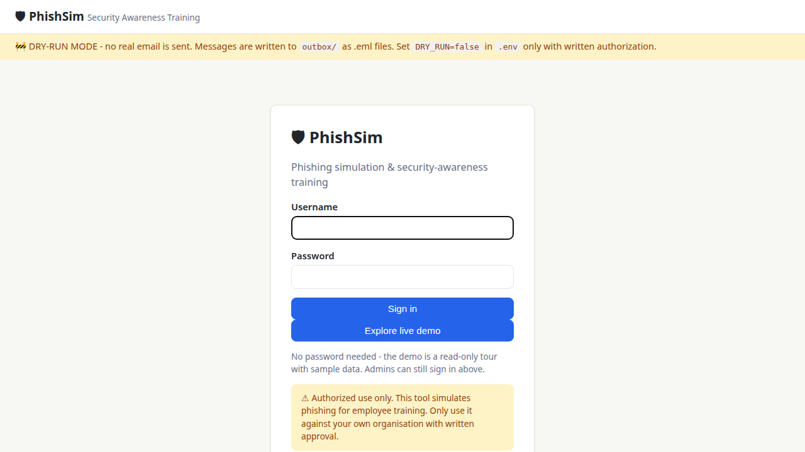 | 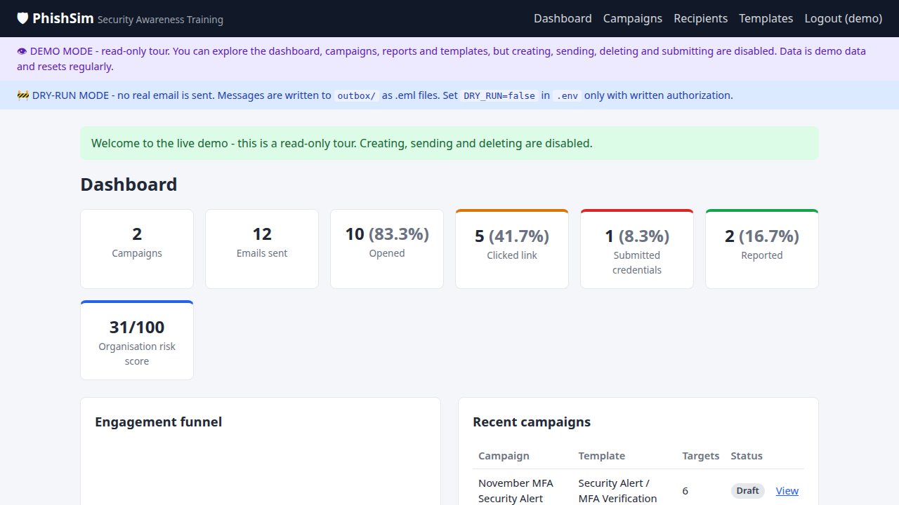 |
| **Engagement funnel & recent campaigns** | **Campaigns at a glance** |
| 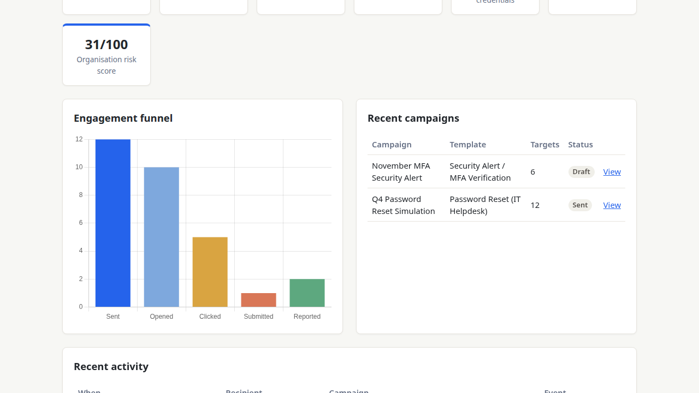 | 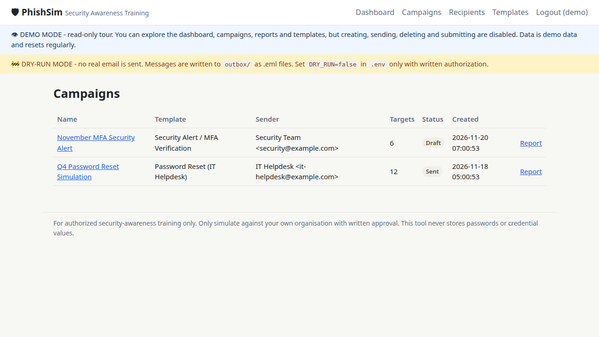 |
| **Build a campaign in minutes** | **Six realistic email templates** |
| 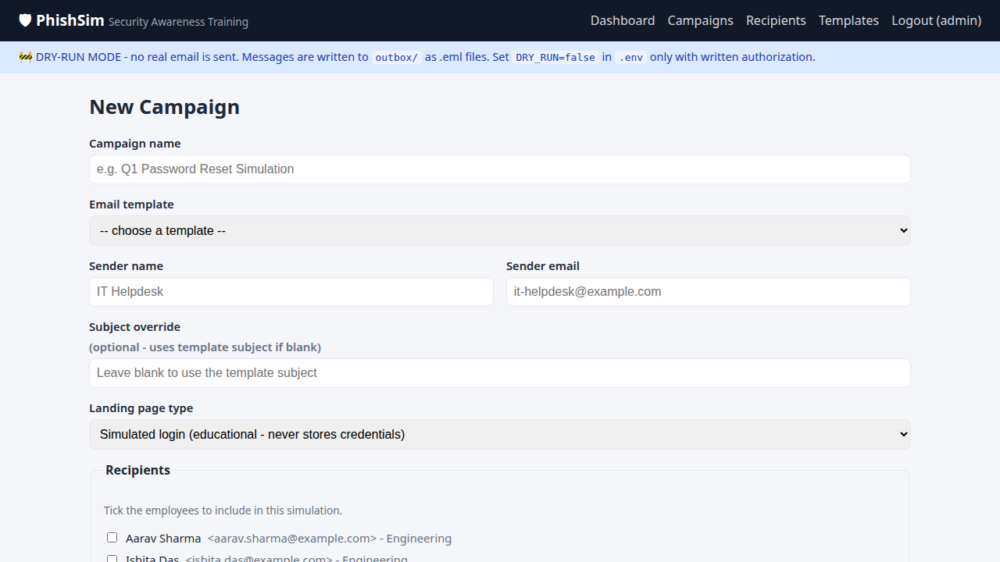 | 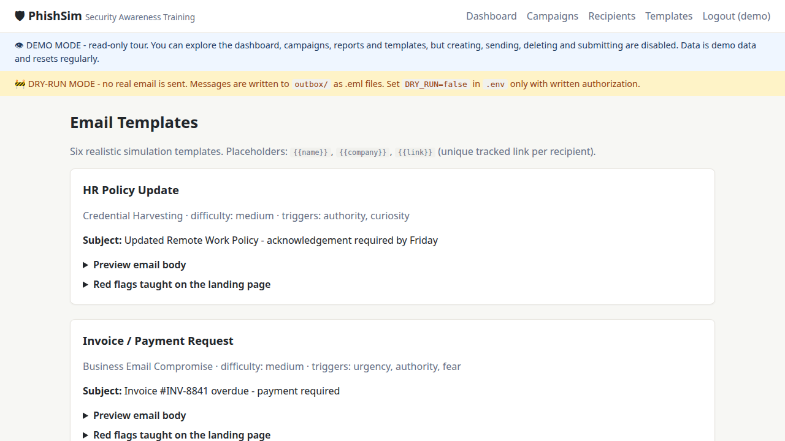 |
| **Campaign report — who clicked, when, how fast** | **Why they clicked — triggers & timing** |
| 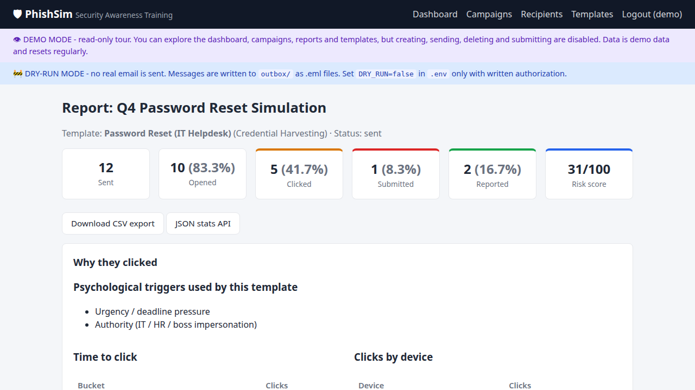 | 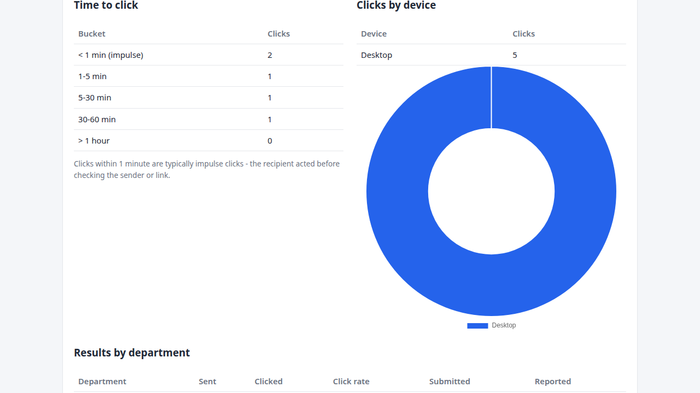 |
| **Tailored training recommendations** | **The teaching moment — red flags explained** |
| 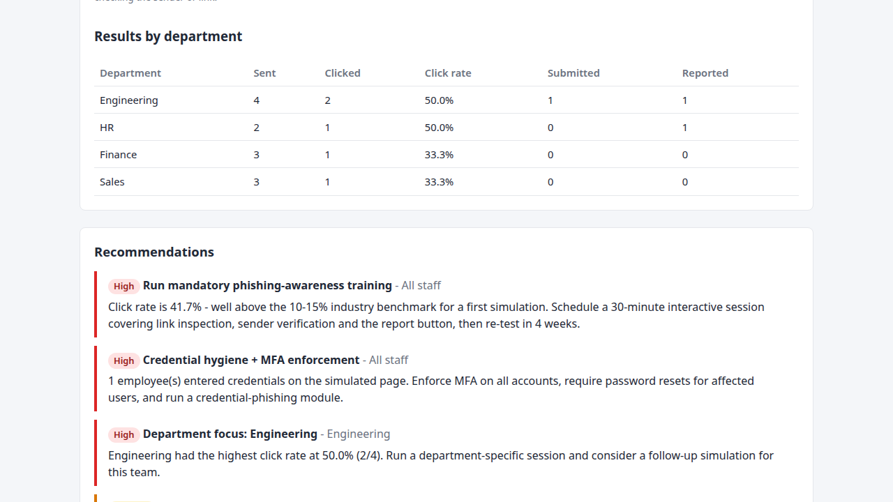 | 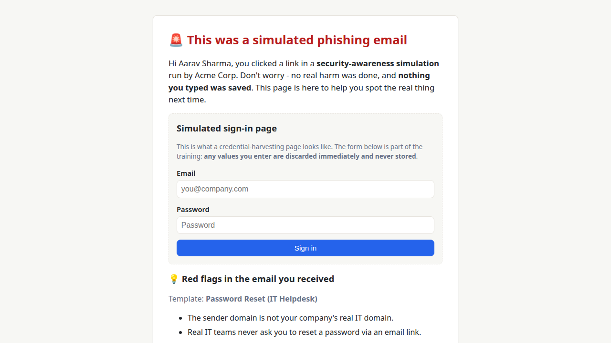 |
| **JSON stats API** | |
| 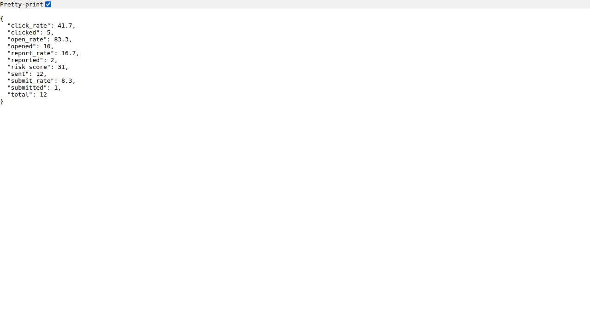 | |

## 🚀 Live demo

**Try it live: https://phishsim-project-s-of-jyothsna-6125.vercel.app**

Click **Explore live demo** on the login page — no password needed. The demo
is **read-only**: you can browse the dashboard, campaigns, reports and
templates, but creating, sending, deleting and submitting are disabled, and
the deployment can never send email (`DRY_RUN=true`, `DEMO_MODE=true`).

> **Note on demo data:** on Vercel the SQLite database lives in the
> serverless function's ephemeral `/tmp` directory, so it resets whenever
> the function cold-starts. The demo dataset (12 employees, a sent
> campaign with realistic results, and a draft campaign) is automatically
> re-seeded on cold start, so the live demo is never empty — but don't
> treat it as persistent storage. For real training runs, self-host the
> app (see Quick start) where the database persists.

> `phishsim.vercel.app` belongs to an unrelated project — use the
> team-scoped URL above.

## 🏗️ Architecture

```
                    ┌──────────────────────┐
                    │  Browser (admin UI)  │
                    │  Dashboard / Reports │
                    └──────────┬───────────┘
                               │ HTTP
                    ┌──────────▼───────────┐
                    │   Flask app (app.py) │  session auth, routes
                    │  ┌─────────────────┐ │
                    │  │ mailer.py       │ │  smtplib / dry-run outbox
                    │  │ analysis.py     │ │  stats, triggers, suggestions
                    │  │ db.py           │ │  sqlite3 schema + helpers
                    │  └─────────────────┘ │
                    └──────────┬───────────┘
                               │
              ┌────────────────┼────────────────┐
              ▼                ▼                ▼
   SQLite (instance/)   outbox/*.eml      SMTP server
   campaigns, targets,  (dry-run only)    (live mode only)
   events, templates
```

Tracking flow: email → `/t/open/<token>.png` (pixel) → `/t/click/<token>`
(logs + redirects) → `/landing/<token>` (education) → optional
`/t/report/<token>`.

## ⚡ Quick start (< 5 minutes)

```bash
git clone https://github.com/DareToCrack/phishsim.git
cd phishsim

python3 -m venv .venv
source .venv/bin/activate

pip install -r requirements.txt

# Load demo data: 6 templates, 12 employees, 2 campaigns (1 sent, 1 draft)
python3 seed.py

# Start the app (dry-run mode - sends NO real email)
python3 app.py
```

Open **http://localhost:5000** and sign in:

| | |
|---|---|
| Username | `admin` |
| Password | `changeme` |

> Change `ADMIN_PASS` in `.env` before any real deployment — the dashboard
> warns you until you do.

### Try the demo

1. Dashboard shows the seeded "Q4 Password Reset Simulation" results.
2. Open **Campaigns → November MFA Security Alert** (draft), tick the
   authorization checkbox and click **Send campaign now** — in dry-run mode
   the emails land in `outbox/` as `.eml` files.
3. Open an `.eml` file, copy its tracking link, and visit it in your browser
   to see the click → landing-page education flow.
4. Open **Report** on the Q4 campaign to see triggers, time-to-click,
   department breakdown and tailored recommendations.

## 📧 Sending real email (live mode)

1. Get **written authorization** from the organisation being tested.
2. Copy `.env.example` to `.env` and set:
   ```bash
   DRY_RUN=false
   ALLOWED_DOMAINS=yourcompany.com
   SMTP_HOST=smtp.gmail.com
   SMTP_PORT=587
   SMTP_USER=you@yourcompany.com
   SMTP_PASS=<app-password>
   SMTP_USE_TLS=true
   SMTP_FROM=security-training@yourcompany.com
   BASE_URL=https://your-public-url
   ADMIN_PASS=<strong-password>
   SECRET_KEY=<long-random-string>
   ```
3. For local testing without a real mail server, use
   [MailHog](https://github.com/mailhog/MailHog):
   `docker run -p 1025:1025 -p 8025:8025 mailhog/mailhog`
   (default SMTP settings already point at it) and view mail at
   http://localhost:8025.

Live sends are blocked unless **every** recipient domain is on the
`ALLOWED_DOMAINS` allowlist, and the operator ticks the authorization
checkbox on every send.

## ☁️ Deploying to Vercel

The repo ships Vercel-ready: `app.py` exposes a top-level Flask `app`,
which Vercel's Flask framework support serves directly, and `config.py`
automatically uses `/tmp/phishing_sim.db` when the `VERCEL` env var is set.

1. Import this repo in Vercel (or `vercel --prod` from the project
   directory).
2. Set these **production** environment variables in the Vercel project:
   `SECRET_KEY` (long random string), `ADMIN_PASS` (strong password),
   `DRY_RUN=true`, `DEMO_MODE=true`, `BASE_URL=https://<your-app>.vercel.app`,
   `COMPANY_NAME=Acme Corp`, `ALLOWED_DOMAINS=` (empty — no live sends).
3. Deploy. The first cold start seeds the demo dataset automatically.

Never set `DEMO_MODE=false` + `DRY_RUN=false` on a public deployment —
that combination could send real email from a public URL.

## 🧪 Testing

```bash
python3 -m pytest tests/ -v
```

**26 tests** cover auth, campaign creation, the authorization gate, dry-run
sending, open/click/report tracking, the landing page (including proof that
submitted passwords are never stored), reporting, CSV export, the JSON API,
security headers, the Chart.js data attributes, and the read-only demo-mode
guards (demo login, blocked writes, blocked fake-login submit, sending
disabled for admins too in demo mode).

## 📁 Project structure

```
phishsim/
├── app.py                 Flask app: routes, auth, tracking, reporting
│                          (also the Vercel framework entrypoint)
├── vercel.json            Vercel project config
├── config.py              Env-based config (dry-run ON by default)
├── db.py                  SQLite schema + connection helpers (stdlib sqlite3)
├── mailer.py              smtplib sender + dry-run .eml outbox
├── analysis.py            Stats, "why they clicked", suggestions engine
├── templates_data.py      6 built-in email templates + red flags
├── seed.py                Demo data: 2 campaigns, 12 employees
├── requirements.txt       Flask, python-dotenv, pytest
├── .env.example           Annotated config template
├── sample_data/employees.csv
├── docs/screenshots/      UI screenshots used in this README
├── templates/             Jinja2: base, dashboard, campaigns, report, landing…
├── static/css/style.css   Vanilla CSS, responsive
├── static/js/             dashboard.js, report.js, app.js (Chart.js via CDN)
└── tests/test_app.py      Flask test-client suite (26 tests)
```

## 🔒 Safety & ethics

- **Authorization first.** Never simulate against people or organisations
  without written approval. The send flow requires an explicit confirmation.
- **No credentials stored.** The simulated login page discards all form input
  immediately; only a `submitted` event + timestamp is recorded.
- **Identifiable as a simulation.** Every email carries
  `X-Phishing-Simulation: true`, `X-Simulation-ID`, and `List-Unsubscribe`.
- **Dry-run default.** Until SMTP is configured and `DRY_RUN=false` is set,
  nothing leaves the machine.
- **Allowlisted domains.** Live mode refuses recipients outside
  `ALLOWED_DOMAINS`.
- **Blame-free reporting.** Reports are for training, not punishment — the
  suggestions engine recommends coaching, not sanctions.

## 🗺️ Roadmap

- Scheduled sends (send campaigns at a future time / staggered delivery)
- Per-template A/B testing and difficulty progression across campaigns
- Attachment-based simulations (macro / QR-code lures) with safe handling
- SSO / role-based admin access instead of a single shared login
- PDF report export and scheduled email digests for managers
- Integration with a SIEM / webhook alerts when submit rates spike

## 👩‍💻 Author

**Potta Jyothsna** — Cybersecurity student (CEH & CLLMSE) at Parul
University, focused on VAPT and AI security. Open to internships.

- 🌐 Portfolio: [pottajyothsna.vercel.app](https://pottajyothsna.vercel.app/)
- 💼 LinkedIn: [linkedin.com/in/jyothsna6125](https://www.linkedin.com/in/jyothsna6125/)
- 🐙 GitHub: [github.com/DareToCrack](https://github.com/DareToCrack)

If this project helped you, a ⭐ on the repo is appreciated!

## 📄 License

MIT — free for educational and authorised training use.
